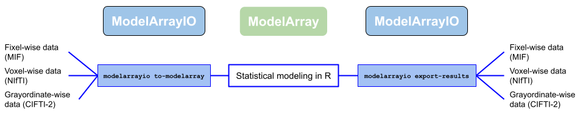

============
ModelArrayIO
============

.. image:: https://img.shields.io/pypi/v/modelarrayio.svg
   :target: https://pypi.python.org/pypi/modelarrayio/
   :alt: Latest Version

.. image:: https://img.shields.io/pypi/pyversions/modelarrayio.svg
   :target: https://pypi.python.org/pypi/modelarrayio/
   :alt: PyPI - Python Version

.. image:: https://img.shields.io/badge/License-BSD%203--Clause-blue.svg
   :target: https://opensource.org/licenses/BSD-3-Clause
   :alt: License

.. image:: https://readthedocs.org/projects/modelarrayio/badge/?version=latest
   :target: http://modelarrayio.readthedocs.io/en/latest/?badge=latest
   :alt: Documentation Status

.. image:: https://github.com/PennLINC/ModelArrayIO/actions/workflows/tox.yml/badge.svg
   :target: https://github.com/PennLINC/ModelArrayIO/actions/workflows/tox.yml
   :alt: GitHub Actions: Tox

.. image:: https://codecov.io/gh/pennlinc/modelarrayio/branch/main/graph/badge.svg
   :target: https://codecov.io/gh/pennlinc/modelarrayio
   :alt: Codecov

.. image:: https://img.shields.io/badge/code%20style-ruff-000000.svg
   :target: https://github.com/astral-sh/ruff
   :alt: Code style: ruff

**ModelArrayIO** is a Python package that converts between neuroimaging formats (fixel ``.mif``, voxel NIfTI, CIFTI-2 dscalar/pscalar/pconn) and the HDF5 (``.h5``) layout used by the R package `ModelArray <https://pennlinc.github.io/ModelArray/>`_. It can also write ModelArray statistical results back to imaging formats.

**Relationship to ConFixel:** The earlier project `ConFixel <https://github.com/PennLINC/ConFixel>`_ is superseded by ModelArrayIO. The ConFixel repository is retained for history (including links from publications) and will be archived; new work should use this repository.

Documentation for installation and usage: `ModelArrayIO on GitHub <https://github.com/PennLINC/ModelArrayIO#installation>`_ (this README). For conda, HDF5 libraries, and installing the ModelArray R package, see the ModelArray vignette `Installation <https://pennlinc.github.io/ModelArray/articles/installations.html>`_.

.. readme-overview-figure-placeholder

.. readme-overview-figure-end

ModelArrayIO provides three converter areas, each with import and export commands:

Once ModelArrayIO is installed, these commands are available in your terminal:

* Neuroimaging data (CIFTI, NIfTI, or MRtrix ``.mif``):

  * Neuroimaging → ``.h5``: ``modelarrayio to-modelarray``
  * ``.h5`` → Neuroimaging: ``modelarrayio export-results``

Storage backends: HDF5 and TileDB
=================================

ModelArrayIO supports two on-disk backends for the subject-by-element matrix:

* HDF5 (default), implemented in ``modelarrayio/h5_storage.py``
* TileDB, implemented in ``modelarrayio/tiledb_storage.py``

Both backends expose a similar API:

* create a dense 2D array ``(subjects, items)`` and write all values at once
* create an empty array with the same shape and write by column stripes
* write/read column names alongside the data

Notes and minor differences:

* Chunking vs tiling: HDF5 uses chunks; TileDB uses tiles. We compute tile sizes analogous to chunk sizes to keep write/read patterns similar.
* Compression: HDF5 defaults to ``gzip`` level 4; TileDB defaults to ``zstd`` level 5. Compressed outputs use byte shuffle; ``--compression none`` disables the filter pipeline. You can switch TileDB to ``gzip`` for parity.
* Metadata: HDF5 stores ``column_names`` as a sibling dataset under each scalar group. TileDB stores names as JSON metadata, and CIFTI outputs also retain their dedicated column-name arrays.
* Layout: Both backends keep dimensions in the same order and use zero-based indices.

Fast conversion and input sources
=================================

``modelarrayio to-modelarray`` stages one scalar at a time into a typed,
C-contiguous matrix, then writes that matrix in one backend submission. Use
``--workers N`` to bound how many input sources are loaded concurrently. This
meaning applies to local paths and ``s3://`` URLs, every modality, and both
backends; it does not cap TileDB's internal pools or HDF5 gzip compression
threads. Compression threads default to every CPU available to the process; set
``MODELARRAYIO_HDF5_COMPRESSION_WORKERS`` to cap them, for example on shared
cluster nodes.

``--workers`` previously controlled concurrent TileDB scalar writes.
``--s3-workers`` is a deprecated alias that will be removed in the next
breaking release. A value matching ``--workers`` is accepted; a conflicting
value is rejected.

Local files and materialized DataLad/git-annex symlinks are read directly.
ModelArrayIO never runs ``datalad get`` implicitly; a broken annex symlink
reports an actionable error. S3 sources use one shared connection pool sized
for the loader concurrency. Set ``MODELARRAYIO_S3_ANON=1`` for public buckets.

``--dtype float32`` is the default. ``--dtype float64`` keeps source precision
through decoding, staging, and storage, at twice the staging memory and bytes
written.

Pass ``--timing-jsonl PATH`` to append structured per-scalar and total runtime
records. Outputs are written to a same-filesystem temporary path and validated
before publication. An existing HDF5 file is replaced atomically. Converting
into an existing TileDB directory merges into it: the scalars (and parcel
arrays) written by the run replace their namesakes, every other scalar already
in the directory is kept, and an interrupted publication is rolled back.
